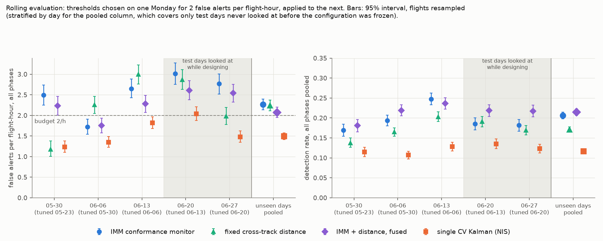
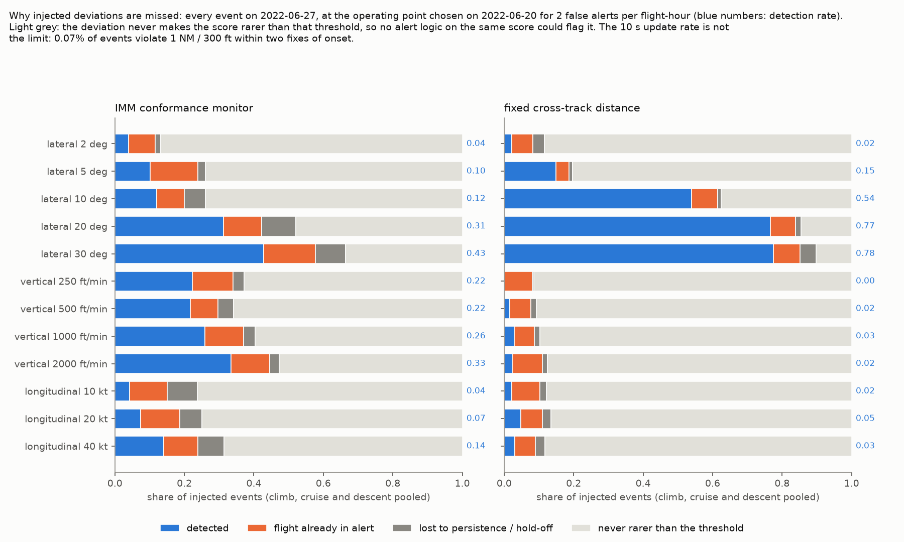
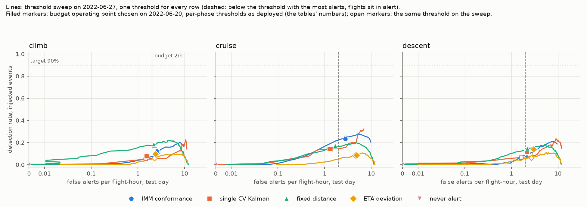
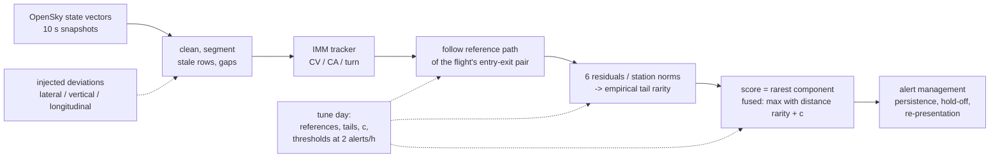

# Trajectory conformance monitoring on real ADS-B traffic

**Can a tracker-based monitor tell that an aircraft is leaving its expected trajectory better
than a fixed cross-track distance alarm, at 2 false alerts per flight-hour? On three Mondays of
OpenSky traffic around Frankfurt that were never looked at during design: yes, but only by a few
points. An IMM tracker scored against learnt route norms catches 20.6% of injected deviations
against the distance alarm's 17.1%, and fusing the two catches 21.5%. Neither comes close to
useful, and the reason is how wide real traffic flows are, not the 10 s update rate.**

[](https://github.com/beriltatli/trajectory-conformance/actions/workflows/ci.yml)
· [Live replay (synthetic traffic)](https://beriltatli.github.io/trajectory-conformance/)
· [Technical report](docs/REPORT.md) · [Design notes](NOTES.md)


*The replay above runs the same detectors and thresholds on synthetic traffic; the real-data
replay stays local because of the data licence.*

## Results

Thresholds are chosen on one Monday for 2 false alerts per flight-hour per phase, then applied
unchanged to the next Monday. The table pools the three test days that were never looked at
before the configuration was frozen (2022-05-30, 06-06, 06-13; 3,842 reference flights,
9,312 injected events). 95% intervals come from resampling flights, stratified by day.

| detector | detection within 600 s | false alerts per flight-hour | detection vs fixed distance (paired) |
|---|---|---|---|
| IMM conformance monitor | 0.206 [0.198, 0.215] | 2.27 [2.14, 2.40] | +0.035 [+0.026, +0.044] |
| fixed cross-track distance | 0.171 [0.164, 0.178] | 2.24 [2.11, 2.37] | |
| IMM + distance, fused | **0.215** [0.206, 0.223] | 2.07 [1.95, 2.20] | **+0.044** [+0.035, +0.052] |

- The intervals cover flight-to-flight variation only. From one test day to the next, detection
  moves by more: 0.17-0.25 for the monitor and 0.14-0.20 for the distance. The fused detector's
  lead over the distance has the same sign on all five test days (+0.03 to +0.05), the
  monitor's on four of five.
- Phase matters. The monitor leads in cruise (+0.07) and descent (+0.03) but loses in climb
  (-0.04), where the distance is strongest on lateral offsets.
- Calibration does not carry over a week. Pooled over the unseen days, the three detectors in
  the table overshoot the 2/h budget they were tuned for (2.07-2.27). On a single test day the
  same thresholds land anywhere between 1.2 and 3.0 alerts per flight-hour
  (`results/phase6_rolling.json`).


**Thresholds chosen on one Monday and applied to the next.** False-alert rates vary by a factor
of two from week to week, yet the fused detector stays ahead of the fixed distance every week.


**Why deviations are missed.** For both detectors, most missed events never make the score rarer
than the threshold. Only 0.07% violate 1 NM / 300 ft within two updates, so the 10 s update
rate is not the limit; the width of the learnt corridor is. The monitor sees vertical rate
offsets that the distance cannot (0.22-0.33 against 0.00-0.03); the distance catches lateral
offsets of 10 deg or more far more often (0.54-0.78 against 0.12-0.43). That split is why
fusing them helps.


**The whole trade-off on one test day (2022-06-27), five detectors.** No detector reaches the
90% target at any alert rate the sweep covers; the best point anywhere is 0.32, at 6.9 false
alerts per flight-hour.

## How it works



- **Tracker.** Genovese (2001) CV-CA-turn IMM with irregular update intervals and a kinematic
  gate. Streaming and batch runs are bit-identical.
- **References.** Each origin-destination pair (airport or 50 km boundary gate) gets a median
  path and per-station norms, built leave-one-out on the tune day. The tails are cross-fitted
  in two folds.
- **Evaluation.**
  - One lateral, one vertical and one longitudinal deviation is injected into its own copy of
    every reference flight, so the real noise, gaps and manoeuvres remain.
  - An event counts as detected if an alert comes within 600 s of onset, and only if the
    uninjected flight was not already alerting.
  - Five rolling folds; flight-level paired bootstrap.
- **Baselines.** Never alert, a single CV Kalman filter scored by NIS, ETA deviation, and the
  fixed cross-track distance. All of them get the same alert management.

## What did not work

- **Per-phase R and q fitted to the filter's innovations.** This centres position and velocity,
  but the tails get heavier and the joint NIS gets worse. Detection moves by at most 0.015.
- **Adapting the norms to each flight's drift.** Adaptation hides deviations as fast as it
  removes off-norm time from normal flights, so there is no gain at an equal alert rate.
- **Splitting a pair's references into flows.** The flows get tighter, but the tails measured
  in station sd get heavier. Detection changes by at most 0.025.

All three are in [the report](docs/REPORT.md#6-what-did-not-work) and in NOTES.md.

## Limitations

- **The deviations are injected, not real.** They are constant heading, vertical rate or speed
  offsets on real flights. False alerts are an upper bound, because some alerts on uninjected
  flights are real deviations (vectoring, shortcuts).
- **Coverage.** Only flights whose pair flew at least 5 times on the tune day are monitored:
  28-38% of test-day flights.
- **The route key looks ahead.** It is taken from the whole uninjected flight, standing in for
  the filed flight plan that OpenSky does not have.
- **Same services every week.** 74-81% of test flights carry a callsign that also flew on the
  tune day, so generalisation to unseen routes is not measured.
- **Calibration does not transfer**, as shown above. The flight bootstrap does not cover
  day-to-day variation, so the intervals understate the uncertainty of a single deployment.
- **Holdout.** Only three of the five test days are untouched; the design was revised while
  looking at 2022-06-20 and 06-27.
- **Scope.** One region, six Mondays, 12:00-18:00 UTC, OpenSky's 10 s snapshots rather than raw
  messages.
- **The filter is not consistent on real data.** Its innovations have a narrow core and a heavy
  tail. A Student-t measurement model, not a rescaled R, would address that. The monitor's
  score does not use the filter covariance, so its results do not rest on it.

## Reproduce

```sh
make env                   # Python 3.12 venv, pinned requirements
make check                 # tests; those that need the OpenSky sample skip without it
make smoke                 # whole pipeline on synthetic traffic, ~15 min, no download (what CI runs)
make demo sim              # the synthetic replay, served on localhost
make reproduce             # OpenSky sample (2 Mondays, ~2.6 GB download) -> results/, figures/
make multiday-data folds   # four more Mondays, five rolling folds -> results/phase6_rolling.json
```

Every number in this README comes from a file in `results/`, and every figure is drawn from
`results/` by `scripts/figures.py`. Seeds are fixed in `config.yaml`. The 2022-06-20 -> 06-27
fold of the rolling evaluation re-runs phase 4 from a separate ingest and must reproduce
`results/phase4_*.json` exactly (`reproduces_results_phase4` in the rolling results).

## Data and licence

OpenSky Network state-vector samples (The OpenSky Network, http://www.opensky-network.org;
Schäfer et al., "Bringing up OpenSky: A large-scale ADS-B sensor network for research", IPSN
2014), used for non-profit research under its terms (`DATA.md`). The data, and anything derived
from it per flight, are not in this repository and not published; only aggregate results are.
The public replay runs on synthetic traffic from `synth/traffic.py`, which is built from public
airport positions and textbook flight profiles and is not fitted to OpenSky data.
