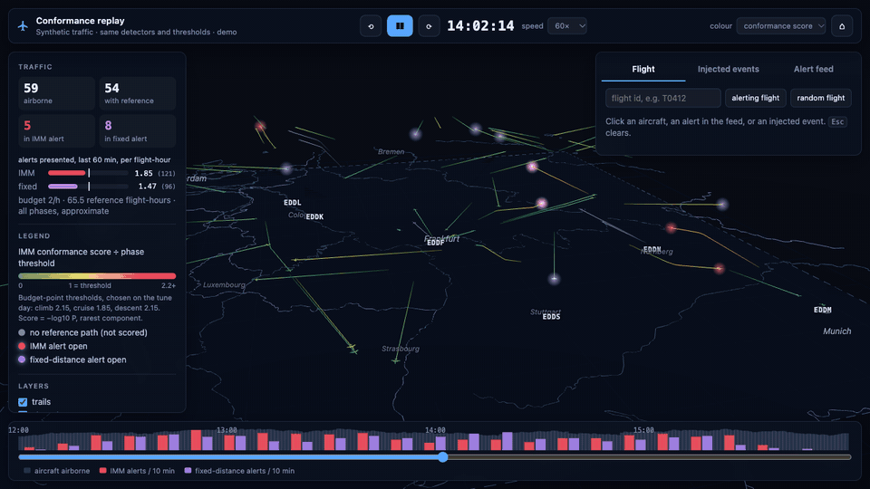
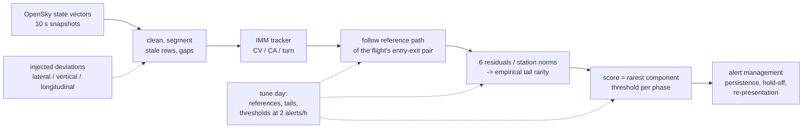

# Trajectory conformance monitoring on real ADS-B traffic

**Does an IMM tracker scored against learnt route norms catch aircraft leaving their expected
trajectory better than a fixed cross-track distance alarm, at 2 false alerts per flight-hour?
On six Mondays of OpenSky traffic around Frankfurt: not overall; it wins on vertical deviations,
loses on lateral ones, and the binding limit is how wide real traffic flows are, not the 10 s
update rate.**

[](../../actions/workflows/ci.yml)
· [Live replay (synthetic traffic)](https://beriltatli.github.io/trajectory-conformance/)
· [Technical report](docs/REPORT.md) · [Design notes](NOTES.md)



<!-- RESULTS -->

## How it works



- **Tracker**: Genovese (2001) CV-CA-turn IMM with irregular intervals, a kinematic gate and
  bit-identical streaming and batch runs.
- **References**: median path and per-station norms of each origin-destination pair (airport or
  50 km boundary gate), built leave-one-out on the tune day; tails cross-fitted in two folds.
- **Evaluation**: one lateral, one vertical and one longitudinal deviation injected into a copy
  of every reference flight; detection within 600 s, credited only if the uninjected flight was
  not already alerting; operating point chosen on one Monday and applied to the next.

## Limitations

<!-- LIMITATIONS -->

## Reproduce

```sh
make env          # Python 3.12 venv, pinned requirements
make smoke        # whole pipeline on synthetic traffic, ~5 min, no download (what CI runs)
make demo         # the synthetic replay in sim/demo/; open sim/index.html via `make sim`
make reproduce    # OpenSky sample (2 Mondays, ~2.6 GB download) -> results/, figures/ (phases 1-5)
make multiday-data folds   # four more Mondays -> results/phase6_rolling.json
python -m scripts.figures rolling
```

Every number in this README is read from a file in `results/`; every figure is drawn from
`results/` by `scripts/figures.py`. Seeds are fixed in `config.yaml`.

## Data and licence

OpenSky Network state-vector samples (The OpenSky Network, http://www.opensky-network.org;
Schäfer et al., "Bringing up OpenSky: A large-scale ADS-B sensor network for research", IPSN
2014), used for non-profit research under its terms (`DATA.md`). The data, and anything derived
from it per flight, are not in this repository and not published; only aggregate results are.
The public replay runs on synthetic traffic from `synth/traffic.py`, which is built from public
airport positions and textbook flight profiles and is not fitted to OpenSky data.
